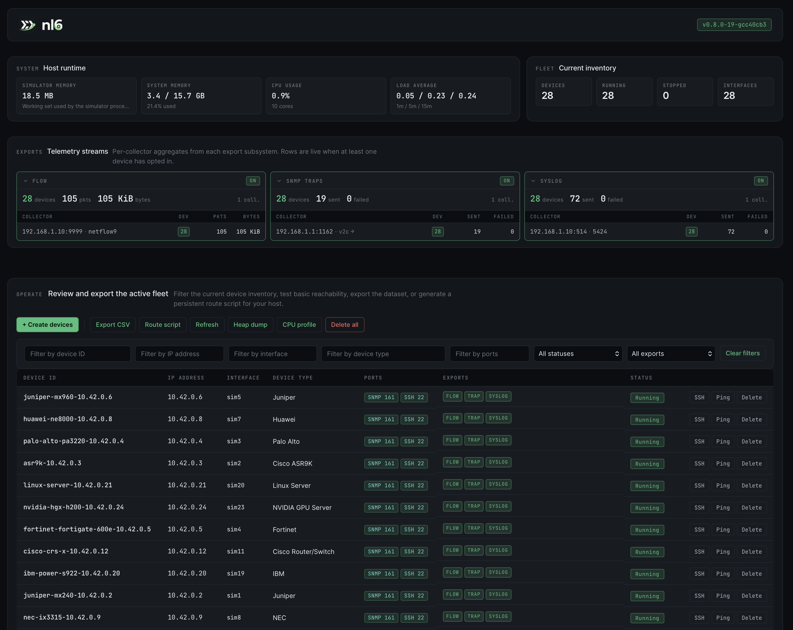

[](https://github.com/labmonkeys-space/nl6/actions/workflows/ci.yml) [](https://nl6.eu/) [](https://github.com/labmonkeys-space/nl6/blob/main/go/go.mod) [](https://github.com/labmonkeys-space/nl6/blob/main/LICENSE) [](https://github.com/labmonkeys-space/nl6/pkgs/container/nl6) [](https://github.com/labmonkeys-space/nl6/releases)



**📖 Documentation: <https://nl6.eu/>**

A scalable network and infrastructure simulator for testing network management software, monitoring systems and automation tools.
Simulated devices serve SNMP v2c/v3, SSH, HTTPS REST, gNMI and NETCONF, and stream flows, traps, syslog, gNMI dial-out and YANG-Push to collectors.
nl6 can simulate tens of thousands of network devices, GPU servers, storage systems and Linux servers.
Each gets its own IP address via Linux TUN interfaces and network namespaces.

## Highlights

- **Runs 30,000+ simulated devices on a single host.** See [Scaling](https://nl6.eu/ops/scaling).
- **31 device types across 9 categories** (core / edge routers, DC and campus switches, firewalls, servers, NVIDIA DGX/HGX GPU servers, enterprise storage, and Ciena Waveserver 5 optical transport). See [Device types](https://nl6.eu/reference/device-types).
- **Multi-protocol per device:** SNMP v2c/v3 (RFC 3414 USM: MD5/SHA1 authentication, DES/AES128 privacy), SSH with VT100 terminal emulation, and HTTPS REST. See [SNMP reference](https://nl6.eu/reference/snmp) and [Web API](https://nl6.eu/reference/web-api).
- **Realistic dynamic metrics:** CPU / memory / temperature on 100-point sine waves; full IF-MIB counter cycling (octets plus per-direction unicast / multicast / broadcast packet counts, errors, discards) with per-device error-scenario tuning (`clean` / `typical` / `degraded` / `failing`); per-GPU DCGM metrics. See [SNMP reference → Dynamic IF-MIB counters](https://nl6.eu/reference/snmp#dynamic-if-mib-counters) and [GPU simulation](https://nl6.eu/reference/gpu).
- **Self-reporting version:** `./nl6 -version`, `GET /api/v1/version`, and a hero-kicker `(vX.Y.Z)` in the web UI all report the running build. You need no source checkout to identify a deployed simulator.
- **Per-device flow export** (NetFlow v5 / v9, IPFIX, sFlow v5) with per-device source IPs. See [Flow export](https://nl6.eu/ops/flow-export).
- **Per-device SNMP trap / INFORM export** (v1, v2c, v3 USM) from a catalog, with a central Poisson scheduler and a global rate cap. Configure with `-trap-collector <host:port>`; see [SNMP traps](https://nl6.eu/ops/snmp-traps).
- **Per-device syslog export** (RFC 5424 / RFC 3164 over UDP, TCP or TLS) from a catalog, with the same scheduler. Configure with `-syslog-collector <host:port>`; see [Syslog export](https://nl6.eu/ops/syslog-export).
- **gNMI streaming telemetry.** Every device serves a read-only OpenConfig dial-in target (gRPC + TLS on `:9339`, SAMPLE / ON_CHANGE / ONCE). It can also **push** telemetry to a collector via gNMI dial-out (Arista `gNMIReverse`, per-device opt-in, mixed fleets supported). See [gNMI target](https://nl6.eu/reference/gnmi) and [gNMI dial-out](https://nl6.eu/reference/gnmi-dial-out).
- **NETCONF (opt-in).** `cisco_catalyst_9500` devices serve the IOS XE draft `establish-subscription` over SSH and push on-change interface notifications. `juniper_mx10004` devices serve the Junos dialect over SSH and mutual TLS, and can **call home** to a NETCONF client over SSH (Junos `outbound-ssh`, per-device opt-in). `huawei_ne8000` devices serve the VRP dialect a YANG-Push collector uses to fetch schemas. Enable with `-netconf-enable`; see [NETCONF](https://nl6.eu/reference/netconf).
- **YANG-Push over UDP-notif (opt-in).** `huawei_ne8000` devices stream interface telemetry as a Huawei NE8000 on VRP does: RFC 9187 UDP-notif, JSON, notification envelope, segmentation, two periodic and one on-change subscription. Checked end to end against NetCalyx. See [YANG-Push over UDP-notif](https://nl6.eu/reference/yang-push-udp-notif).

## Status & scale

| Feature | Status | Note |
|---------|--------|------|
| SNMP v2c, SNMP v3 | Stable | Every USM security level, RFC 3414, verified against net-snmp ([nl6#624](https://github.com/labmonkeys-space/nl6/issues/624)) |
| SSH, HTTPS REST | Stable | REST on storage types |
| NetFlow v5/v9, IPFIX | Stable | |
| sFlow v5 | Experimental | Synthesised from `FlowCache` records with a fixed `sampling_rate`; suits collector-plumbing validation, not link-utilisation benchmarking. See [sFlow caveat](https://nl6.eu/reference/flow-export#sflow-caveat) |
| SNMP traps, syslog | Stable | |
| gNMI dial-in and dial-out | Stable | Read-only |
| NETCONF, call home | Stable | Three dialects, opt-in |
| YANG-Push over UDP-notif | New in v0.40.0 | `huawei_ne8000`, opt-in; the on-change subscription is not verified against a real device |
| TUN per device, `nl6sim` namespace, web UI, REST control plane | Stable | |

**Tested scale:** up to 30,000 concurrent simulated devices on a single host.
**Toolchain:** Go 1.27 or later; canonical version pinned in [`go/go.mod`](go/go.mod).

## Quick start

```bash
git clone https://github.com/labmonkeys-space/nl6.git
cd nl6/go/nl6 && go build -o nl6 .

# Auto-create 5 devices starting at 192.168.100.1
sudo ./nl6 -auto-start-ip 192.168.100.1 -auto-count 5
```

Then query any device:

```bash
snmpget -v2c -c public 192.168.100.1 1.3.6.1.2.1.1.1.0
```

Expected output:

```text
SNMPv2-MIB::sysDescr.0 = STRING: Cisco IOS XR Software, ASR9K Series, Version 7.5.2
```

The same device answers `ssh simadmin@192.168.100.1` (password `simadmin`) and `gnmic -a 192.168.100.1:9339 --skip-verify capabilities`.

Per-device exports (flow + trap + syslog in a single create call):

```bash
# Boot without any export CLI flags. The subsystems are always-on.
sudo ./nl6

# Create 10 devices that all emit IPFIX flows, SNMPv2c traps, and
# RFC 5424 syslog to one collector. Any of the three blocks is optional.
curl -X POST http://localhost:8080/api/v1/devices \
  -H 'Content-Type: application/json' \
  -d '{
    "start_ip": "10.0.0.1",
    "device_count": 10,
    "flow":   {"collector": "192.168.1.10:4739", "protocol": "ipfix"},
    "traps":  {"collector": "192.168.1.10:162",  "mode":     "trap"},
    "syslog": {"collector": "192.168.1.10:514",  "format":   "5424"}
  }'

# Inspect what each subsystem has attached.
curl http://localhost:8080/api/v1/flows/status   | jq '.data.collectors'
curl http://localhost:8080/api/v1/traps/status   | jq '.collectors'
curl http://localhost:8080/api/v1/syslog/status  | jq '.collectors'
```

Link devices into an LLDP topology with `POST /api/v1/topology`; see [LLDP topology](https://nl6.eu/reference/lldp-topology).

Full walkthrough: [Getting started → Quick start](https://nl6.eu/getting-started/quick-start).
Prebuilt packages (`.deb` / `.rpm` / NixOS): [Getting started → Install packages](https://nl6.eu/getting-started/install-packages).
The packaging reference is in [`deploy/packages/`](deploy/packages/README.md).
Container deployment: [Getting started → Docker](https://nl6.eu/getting-started/docker).
Deployment recipes & worked examples: [`examples/`](examples/), with Clos fabrics and a ready-to-run OpenNMS Minion (`docker compose`) stack.

## Documentation map

The docs site has four top-level sections:

- [Getting Started](https://nl6.eu/getting-started/quick-start): build, first run, package install, Ansible, Docker.
- [Operations](https://nl6.eu/ops/scaling): scaling, network namespace, flow export, load-test scenarios, troubleshooting.
- [Reference](https://nl6.eu/reference/cli-flags): CLI flags, web API, device types, SNMP, flow export, resource files, GPU simulation.
- [Explanation](https://nl6.eu/explanation/architecture): architecture, why Kubernetes is out of scope, SNMP data fidelity, measuring a collector's ceiling.

## Contributing

Contributions are welcome.
Work starts from an issue, every commit is signed off (`git commit -s`, the [DCO](https://developercertificate.org/)), and AI-assisted commits carry an `Assisted-by:` trailer.
Run `make check-tidy && make build && make test` before opening a PR.
See [`CONTRIBUTING.md`](CONTRIBUTING.md).

**Cutting a release.** Maintainers: see [`RELEASING.md`](RELEASING.md) for the tag-driven release workflow and the short post-tag verification checklist.

## Support

nl6 is free and open source under the **Apache-2.0** license.
It stands in for a lab full of hardware: 30,000+ devices speaking the protocols above.
If it saved you a test rig, a one-time donation helps keep it maintained: releases, new device types, and protocol upkeep.

- **GitHub Sponsors:** https://github.com/sponsors/indigo423
- **Ko-fi:** https://ko-fi.com/indigo423

No tiers, no gated features.
The simulator stays free for everyone.
A ⭐ or a good issue helps as much, and there's a spot on [SPONSORS.md](SPONSORS.md) if you'd like one. 🙏

## License

Licensed under the Apache License, Version 2.0. See [LICENSE](LICENSE) for details.

## Heritage

Originally forked from [`saichler/l8opensim`](https://github.com/saichler/l8opensim); see commit history for upstream attribution.
