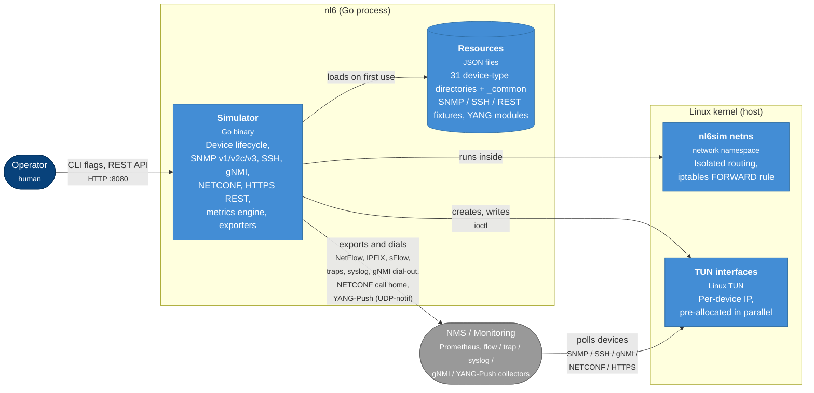

# Architecture

nl6 is a single Go program that stands up thousands of simulated devices inside a dedicated Linux network namespace.
Each simulated device has its own IP address on a TUN interface, its own SNMP listener, its own SSH server, a gNMI server, and, for storage devices, its own HTTPS REST endpoint.

## System overview

The diagram is a [C4 container](https://c4model.com/#ContainerDiagram) view rendered as a Mermaid flowchart.
It shows what lives inside the nl6 process, the host-side Linux infrastructure it depends on, and how operators and monitoring systems reach it.

The namespace was `opensim` before the fork was renamed; see [Network namespace](../ops/network-namespace.md) for the one-time cleanup.

## Management surfaces

| | gNMI dial-in | gNMI dial-out | NETCONF | NETCONF call home | YANG-Push | SSH CLI |
|---|---|---|---|---|---|---|
| **Model** | OpenConfig, plus native origins from a per-type catalogue | Same as dial-in | Cisco native `Cisco-IOS-XE-interfaces-oper` (IOS XE dialect); Junos `NETCONF` event stream (Junos dialect); YANG library and RFC 8639 subscriptions (VRP dialect) | Same as NETCONF, Junos dialect | `ietf-interfaces` in the RFC 8641 YANG-Push notifications | None, CLI text |
| **Encoding** | `JSON_IETF`, `PROTO` | Same as dial-in | XML | XML | JSON in `ietf-yp-notification` envelope | Plain text |
| **Transport** | gRPC over TLS | gRPC over TLS | SSH `netconf` subsystem; TLS 1.2 on `juniper_mx10004` | SSH `netconf` subsystem after the Junos `outbound-ssh` preamble | UDP-notif (RFC 9187), segmented at 1436 bytes | SSH shell |
| **Port (default)** | `9339` | Collector's port | `830` (SSH), `6513` (TLS) | Client's port (`4334`, RFC 8071) | Collector's port | `22` |
| **Who connects** | Collector dials the device | Device dials the collector | Client dials the device | Device dials the client | Device sends to the collector; the collector fetches schemas over NETCONF | Client dials the device |
| **Auth** | Shared server cert signed by the CA at `GET /api/v1/tls/ca`, no client auth | Collector verified by `ca_pem`, optional mTLS | Device SSH login; mutual TLS on `6513` | Device SSH login; the device stays the SSH server | None on the stream; key login (`-netconf-authorized-keys`) for the schema fetch | Device SSH login |
| **Plaintext option** | `-gnmi-tls=false` | `tls.enabled=false` | Not available | Not available | Always plaintext | Not available |
| **Devices** | All | Opt-in per device | `cisco_catalyst_9500`, `juniper_mx10004`, `huawei_ne8000` | `juniper_mx10004`, opt-in per device | `huawei_ne8000`, opt-in per device | All |
| **Default** | On | Off | Off | Off | Off | On |
| **Writes** | No, `Set` is `Unimplemented` | No | No | No | No | No |

gNMI, NETCONF and YANG-Push all carry YANG-modelled data, OpenConfig, IETF or a vendor's native model.
SSH appears in three columns because NETCONF reuses it as a transport: the same login and host key, a different subsystem.
Call home runs the session on a connection the device opens.
YANG-Push is the only surface with two directions: the stream goes out over UDP, and the collector reads the schema back over NETCONF.

### Scope

| Surface | Operations | Devices | Reference |
|---|---|---|---|
| gNMI dial-in | `Capabilities`, `Get`, `Subscribe` in SAMPLE, ON_CHANGE and ONCE mode over `/interfaces` and `/components`; a per-type catalogue with native origins on `cisco_asr9902` and `juniper_mx10004` | All | [gNMI dial-in](../reference/gnmi.md) |
| gNMI dial-out | The dial-in payload pushed over Arista `gnmireverse`, dropped on outage | Opt-in | [gNMI dial-out](../reference/gnmi-dial-out.md) |
| NETCONF, IOS XE dialect | The draft `establish-subscription` with `push-update` and `push-change-update` on interface state; no `get`, no `edit-config`, no RFC 8639 | `cisco_catalyst_9500` | [NETCONF reference](../reference/netconf.md) |
| NETCONF, Junos dialect | `get`, `get-configuration`, `create-subscription` on the `NETCONF` stream, which carries mib2d link events; over SSH and TLS | `juniper_mx10004` | [NETCONF reference](../reference/netconf.md) |
| NETCONF, VRP dialect | `get` on the YANG library, the module list, the subscriptions and their filters; `get-schema` for every served module; no `edit-config` | `huawei_ne8000` | [YANG-Push over UDP-notif](../reference/yang-push-udp-notif.md#what-a-collector-can-fetch) |
| NETCONF call home | The Junos session on a connection the device opens, with the `outbound-ssh` preamble before the SSH banner; one session per client, redial every 15 s; SSH only | `juniper_mx10004`, opt-in | [NETCONF reference](../reference/netconf.md#call-home) |
| YANG-Push | Three subscriptions per device: interface statistics and interface state every 60 s, and on-change `oper-status` and `admin-status`; `subscription-started`, `push-update` and `push-change-update` as captured from an NE8000 on VRP R025C00 | `huawei_ne8000`, opt-in | [YANG-Push over UDP-notif](../reference/yang-push-udp-notif.md) |

## Package layout

| Path | Purpose |
|------|---------|
| `go/nl6/` | Core simulator, with all device simulation logic and tests. |
| `go/nl6/resources/` | Per-device-type JSON resource files (SNMP / SSH / REST) across 31 device-type directories, the shared trap, syslog and NBAR2 catalogs under `_common/`, and the YANG modules `huawei_ne8000` serves. |
| `go/nl6/worldcities/` | The `sysLocation` city dataset: 97 CSV shards plus `header.csv`, about 47,000 rows. |

The [`Makefile`](https://github.com/labmonkeys-space/nl6/blob/main/Makefile) is the canonical build entry point.

## Core simulator components

| Component | Responsibility | Files | Reference |
|-----------|----------------|-------|-----------|
| Device lifecycle | CLI entry, `SimulatorManager` with shared keys and certs, per-device startup and protocol server lifecycle | `simulator.go`, `manager.go`, `device.go` | |
| SNMP stack | Request handling, OID lookup via `sync.Map`, response building, ASN.1 BER/DER | `snmp_server.go`, `snmp.go`, `snmp_handlers.go`, `snmp_response.go`, `snmp_encoding.go` | [SNMP reference](../reference/snmp.md) |
| SNMPv3 | Message framing, DES / AES128 privacy, RFC 3414 USM key derivation, HMAC-MD5-96 / HMAC-SHA-96 and inbound verification, verified against net-snmp | `snmpv3.go`, `snmpv3_crypto.go`, `snmpv3_usm.go` | [SNMP reference](../reference/snmp.md) |
| SNMP SET | `SetRequest` on `ifAdminStatus` through the RFC 3416 ladder, gated by a write community (v1/v2c) and a minimum security level (v3) | `snmp_set.go` | [Enable SNMP SET](../getting-started/snmp-set.md) |
| Interface state | Link and admin state per ifIndex, flap scheduler, REST control, link traps and syslog | `interface_state.go`, `if_counters.go` | [Interface state](../reference/interface-state.md) |
| Metrics engine | 100-point pre-generated sine-wave patterns per device, per-GPU metrics, per-category baselines | `metrics_cycler.go`, `gpu_metrics.go`, `device_profiles.go` | [GPU simulation](../reference/gpu/index.md) |
| Network infrastructure | TUN interfaces, the `nl6sim` namespace, parallel pre-allocation (100 to 200 workers by default, sized by batch; `max_workers` overrides it, clamped to 500) | `tun.go`, `netns.go`, `prealloc.go` | [Network namespace](../ops/network-namespace.md) |
| Web API | The control plane: routes, handlers, Linux route script generation | `web.go`, `api.go`, `web_routes*.go` | [Web API](../reference/web-api.md) |
| Flow export | NetFlow v5 / v9, IPFIX, sFlow v5 encoders behind one `FlowEncoder` interface; a socket per collector and protocol, or per device under `-flow-source-per-device` (the default); one ticker goroutine | `flow_exporter.go`, `netflow5.go`, `netflow9.go`, `ipfix.go`, `sflow.go` | [Flow export reference](../reference/flow-export.md) |
| Trap export | Catalog-driven SNMP traps and informs, central Poisson scheduler with a global rate cap | `trap_*.go` | [SNMP traps](../reference/snmp-traps.md) |
| Syslog export | Catalog-driven RFC 5424 / 3164 messages over UDP, TCP or TLS, same scheduler shape as traps | `syslog_*.go` | [Syslog export reference](../reference/syslog-export.md) |
| gNMI dial-in | Path resolver, `Capabilities` / `Get` / `Subscribe` handlers, per-stream ticker with a bounded send buffer, per-device gRPC listener | `gnmi_paths.go`, `gnmi_handlers.go`, `gnmi_subscribe.go`, `gnmi_server.go`, `gnmi_manager.go` | [gNMI dial-in](../reference/gnmi.md) |
| gNMI dial-out | Per-device gRPC client: one `ClientConn` and one `Publish` stream, reconnect with backoff, the same payload as dial-in with `Prefix.Target` set to the device IP | `gnmi_dialout_*.go` | [gNMI dial-out](../reference/gnmi-dial-out.md) |
| NETCONF | Per-device SSH `netconf` subsystem on `cisco_catalyst_9500`, `juniper_mx10004` and `huawei_ne8000`, plus a mutual-TLS listener on `juniper_mx10004`; IOS XE draft subscriptions and Junos link events pushed from the interface state engine; the VRP dialect answers a YANG-Push collector's schema fetch | `netconf_*.go`, `netconf_vrp.go` | [NETCONF reference](../reference/netconf.md) |
| YANG-Push | Per-device UDP-notif exporter: three subscriptions, periodic updates from the counter cycler and on-change updates from the interface state engine, UDP-notif framing and segmentation, the served YANG library and its content-id | `yangpush_*.go` | [YANG-Push over UDP-notif](../reference/yang-push-udp-notif.md) |
| Optical engine | Received power, OSNR, pre-FEC BER and FEC block counters per OCH component, health bands and degradation episodes | `optical_*.go` | [Optical telemetry](../reference/optical-telemetry.md) |
| Load-test scenarios | Armed, windowed experiments that gate push protocols and write a sent-ledger report | `scenario_*.go` | [Load-test scenarios](../reference/loadtest-overview.md) |
| Continuous profiling | Runtime-togglable Pyroscope push and the gated `/debug/pprof/` surface, off by default | `profiling.go`, `profiling_api.go` | [Profiling](../ops/profiling.md) |
| Prometheus service discovery | One HTTP SD target group per running device for snmp_exporter | `prometheus_sd.go` | [Prometheus service discovery](../reference/prometheus-sd.md) |
| LLDP topology | Inter-device link graph and the dynamic LLDP-MIB provider | `topology.go`, `lldp_table.go` | [LLDP topology](../reference/lldp-topology.md) |
| DNS service discovery | Hidden-primary zone over the live device map for a CoreDNS secondary | `dns_*.go` | [DNS service discovery](../reference/dns-service-discovery.md) |
| Resource loading | Loads and caches a device type the first time a device of that type is created; only the auto-start default, `asr9k`, loads at startup | `resources.go` | [Resource files](../reference/resource-files.md) |

## Key design decisions

| Choice | Gained | Given up |
|--------|--------|----------|
| `sync.Map` for OID lookups | Lock-free O(1) reads under concurrent SNMP load | Simple iteration; walks need the pre-computed next-OID map |
| Pre-computed next-OID mappings | `GETNEXT` and `WALK` without scanning the table | Memory per loaded device type |
| Buffer pool on the SNMP path | Less GC pressure at high request rates | Every handler path must return its buffer to the pool |
| Shared SSH and TLS keys across all devices | No per-device key generation, so 30,000 devices start in minutes | Every device presents the same host key and certificate; nl6 does not model PKI |
| Analytic IF-MIB counters | Every `ifTable` and `ifXTable` counter is computed on demand from a per-direction sine wave, with no polling loop | Traffic shapes other than the sine wave. See [SNMP reference](../reference/snmp.md#dynamic-if-mib-counters) |
| One counter dispatcher | SNMP, gNMI, sFlow and YANG-Push read `IfCounterCycler.GetDynamicAt`, so every protocol reports the same number at the same instant | A protocol cannot carry its own traffic model |
| Network namespace isolation | The `nl6sim` namespace keeps systemd-networkd off the TUN interfaces | Linux only, and root is required |
| Per-device flow egress | A `FORWARD -i veth-sim-host -j ACCEPT` rule lets per-device exporters send out of the namespace on Docker hosts that default `FORWARD` to `DROP` | An iptables dependency in the image; the rule is removed in `NetNamespace.Close` |

## Container image

`ghcr.io/labmonkeys-space/nl6`, `:rc` from every push to `main` and `:vX.Y.Z` plus `:latest` from a release tag.
See [Docker](../getting-started/docker.md) to run it and [RELEASING.md](https://github.com/labmonkeys-space/nl6/blob/main/RELEASING.md) for the pipeline.
